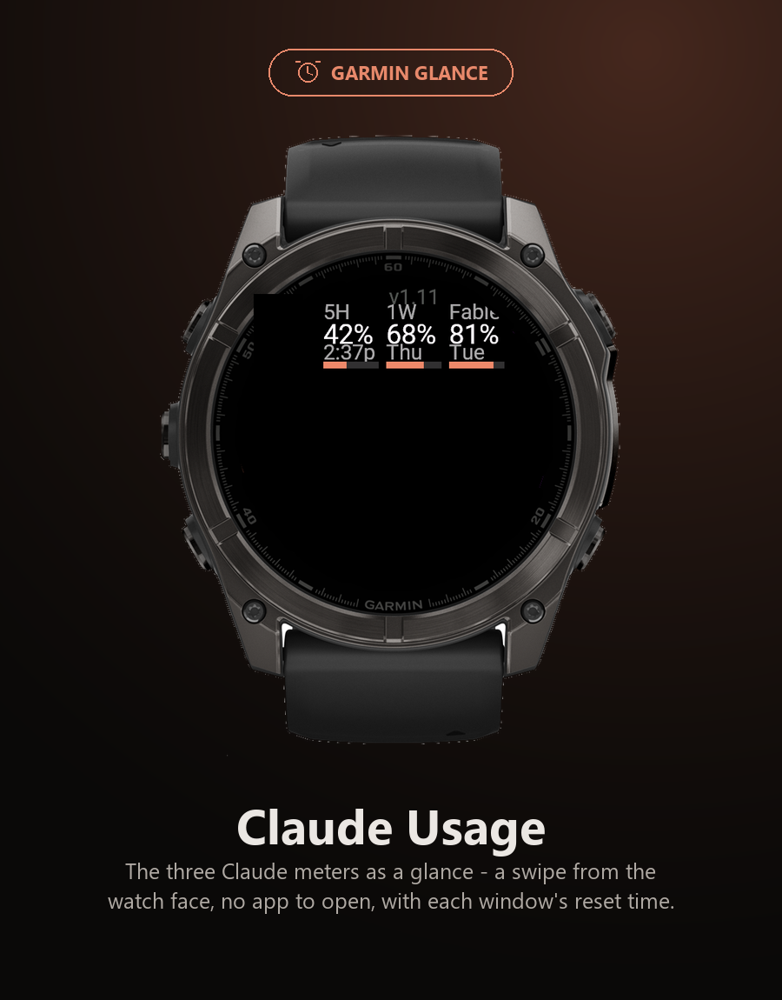

# Claude Usage - Garmin watch app

A glance for fenix 8 class watches, including the **tactix 8**, showing the same three meters
as the phone widget: `5H`, `1W`, and the per-model weekly cap. Each meter also shows when it
resets, as a wall-clock time the way the Claude usage menu states it - a clock time for the
5-hour session (`9:27p`), a weekday for the weekly caps (`Tue`), or a month/day once a reset
is more than a week out (`Sep 22`). Honours the watch's 12/24-hour setting.

Opening the app shows **one page per provider - Claude, Codex, Cursor** - in a `ViewLoop`:
swipe or press up/down to turn the page (it wraps), and the system draws the page dots. Each
page lists the windows the phone sent (Codex `5H` / `1W`; Cursor plan / `Auto` / `API`), with
its own "updated … ago" line, since each provider has its own fetch time. The page code is
shared with the [Codex + Cursor app](../feed-app/README.md) (`../shared/source-usage/`).

<p align="center">

</p>

Generated: 2026-09-17 · Updated: 2026-10-22 (provider pages, fourth complication, shared code)

## The watch never talks to Claude

It renders numbers pushed from the Android app over BLE, and holds nothing else. Two reasons
it must work this way, either one decisive:

- **Cloudflare.** `cf_clearance` is minted by solving a JS challenge in a real browser engine,
  which is why the phone app carries a WebView. Connect IQ's `makeWebRequest` is a plain HTTP
  client with no JS engine, so claude.ai answers it with a 403.
- **Credential blast radius.** A Claude `sessionKey` in Connect IQ `Application.Storage` is
  unencrypted, on a device worn outdoors and handed to people. On the phone it sits in
  `EncryptedSharedPreferences` behind the Android keystore.

## Device profile

`fenix847mm` **is** the tactix 8 47mm/51mm profile - Garmin ships fenix 8 / tactix 8 / quatix 8
as one Connect IQ device, which the simulator title bar confirms. There is no separate
`tactix8` profile to install.

## Build

Requires the Connect IQ SDK and a developer key (both already installed on this machine -
SDK 9.2.0 under `%APPDATA%\Garmin\ConnectIQ\Sdks`, key at `~/.garmin-keys/developer_key.der`).

```
monkeyc -f monkey.jungle -o build/ClaudeUsage.prg \
        -y ~/.garmin-keys/developer_key.der -d fenix847mm
monkeydo build/ClaudeUsage.prg fenix847mm      # loads it into a running simulator
```

## Testing the phone link without a watch

The Connect IQ simulator talks to the companion app running on an Android device **or
emulator** over adb, at simulated BLE speeds - no physical watch, and no Garmin Connect
Mobile. Verified working end to end on 2026-09-16.

```
./gradlew assembleDebug -PciqTethered=true && adb install -r app/build/outputs/apk/debug/app-debug.apk
adb forward tcp:7381 tcp:7381
monkeydo garmin/watch-app/build/ClaudeUsage.prg fenix847mm
```

**Order matters, and it is the one thing that will waste your afternoon.** The phone app is
the *server*: its SDK opens port 7381 only while a push is running, and the simulator's
connect attempt does not retry. So:

1. Trigger a refresh on the phone (tap the widget). The app logs
   `ConnectIQ-AdbConnection: Waiting for simulator connection.` and the socket is now open.
   It stays open for as long as the app process lives.
2. **Then** in the simulator: **adb Connection > Start** (Ctrl-F1). It logs
   `Simulator connected`.
3. Trigger another refresh. That one lands: `Wrote N bytes to output stream` /
   `ClaudeWatch: watch updated: Simulator`.

Clicking Start first connects to nothing and looks identical to a broken bridge.

## Testing in the simulator without a phone

The simulator can deliver a phone message itself: **Simulation > Phone App Message** takes a JSON
dictionary in the message box (the keys in [`../CONTRACT.md`](../CONTRACT.md); numbers arrive as
Numbers, strings as Strings) and a target app. That reaches `onPhone` exactly as a push does, so
the pages, the group rules and the glance can be checked with any numbers. **Settings > Glance
Launch Mode > Launch in Normal Mode** opens the app instead of the glance; **Simulation >
Background Events** fires the temporal event, whose publish is the background path a face reads.

Unit tests for `Snapshot.store()` and the launch page live in
`../shared/source-usage/UsageTests.mc` (`(:test)`, so they never reach a sideloaded build):

```
monkeyc -f monkey.jungle -o build/test.prg -y ~/.garmin-keys/developer_key.der -d fenix847mm --unit-test
monkeydo build/test.prg fenix847mm /t
```

## Complications

Four meters are published as watchface complications (ids 0-3 in
`resources/complications.xml`, public access so any watchface incl. Face It can show them):
Claude's `5H`, `1W` and per-model cap, and Cursor's `API` pool. Each is a percentage with a short
label and colour-zone ranges; the reset time rides in `unit` as an epoch-seconds string.

**Four is Connect IQ's limit per app** - `monkeyc` refuses a fifth ("Exceeds maximum of 4
complications"). The other Codex and Cursor meters are published by the
[Codex + Cursor app](../feed-app/README.md), which gets the same phone message.

**Publishing must run from a background service.** A device app that calls
`Complications.updateComplication()` from the foreground faults with an *uncatchable*
"Illegal Access (Out of Bounds)" - confirmed, and confirmed on the Garmin forums. So
`BackgroundService.mc` publishes on a temporal event (Connect IQ's 5-minute floor), which
the app registers in `onStart`. The values are whatever the phone last pushed into Storage.

Open the app once after install so `onStart` registers the temporal event; from then on the
background service republishes every ~5 minutes.

> Not verifiable in the headless simulator (the sim can't be driven to its
> Simulation > Complications viewer here, and foreground publishing faults by design).
> Confirm on a real watch by adding a Claude complication to a watchface.

## Layout note

Most of the code is shared with the Codex + Cursor app and lives in
[`../shared/source-usage/`](../shared/README.md): `Snapshot` (the message keys, their groups and
storage), `UsagePages` (the provider pages), `UsageApp` (start-up and the launch page),
`UsagePublish`, the background service and `Version`. This folder keeps what is Claude Usage's
own: the App class, the glance and `Publisher` (which meter goes to which of its four ids).

Glance code is compiled into its own restricted memory space, so `Snapshot` and the glance
view are annotated `(:glance)`. `Snapshot`, `Publisher`, `UsagePublish` and the background
service are also `(:background)` because the complication publish runs in the background
context. Anything those contexts touch needs the matching annotation.

**`onStart()` runs in the background too.** The compiler adds the App class to the background
image (the "entry point … implicitly added to the background process" warning), and the system
calls `onStart()` when it starts the background service. So everything `onStart()` touches must
be `(:background)` - that is why `UsageApp` is, and the page views (in `UsagePages`) are not
called from there. A foreground-only module called from `onStart()` faults the background start
with an uncatchable "Illegal Access (Out of Bounds)".

**A `ViewLoopFactory.getView()` must return `[view, delegate]`.** The docs allow a bare `[view]`,
but the loop reads index 1 regardless and the app fails to start with "Array Out Of Bounds
Error" and no stack (SDK 9.2.0). The pages return a plain `BehaviorDelegate`.

## Cutting a release

The watch version is a manual constant in `../shared/source-usage/Version.mc`, shared with the
Codex + Cursor app (the `.prg` files are built locally, not by CI). Bump it to the release
version, rebuild both apps' `dist/` with `monkeyc -r`, and attach the `.prg` files to the GitHub
release alongside the APK.
